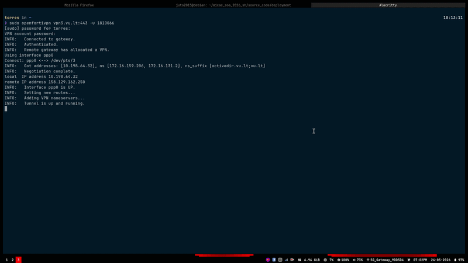

# MICAC_SoA_2026_SH
### Project Name: Ship Happens

  
  
  
  
  
  
  
  
  
  
  
  
  
  

### Authors 
- Ariana Sofia Domingues Vaz Silva Alves
- Greivin Sanchez Garita
- Juan Luis Torres Ramos

## Project Overview
The primary objective of this framework is to mitigate risks within the Software Supply Chain by identifying "Zombie Packages". These are defined as dependencies that, despite having no documented vulnerabilities (CVEs), have been abandoned by their maintainers. These "stale" components represent a critical security blind spot, as they are unlikely to receive patches for future exploits.

To address this, the system implements a risk heuristic that evaluates every dependency on a scale of 0 to 100. This score determines if a package has reached a "zombie state" based on four safety pillars:

* **Vulnerability Exposure:** Cross-referencing with the OSV (Open Source Vulnerability) database.
* **Maintenance Vitality:** Detection of project stagnation through commit frequency analysis.
* **Maintenance Redundancy:** Calculating the "Bus Factor" to identify dependencies reliant on a single point of failure.
* **Community Health:** Assessing issue neglect as a lead indicator of package abandonment.

A dependency is formally classified as a Zombie Package if it exceeds the 100-point risk threshold or carries an explicit deprecation flag. Consequently, the final repository grade (**Safe**, **Warning**, or **Dangerous**) is dictated by the highest risk score found within its dependency tree.
## Demo Presentation
Below is a demonstration of how the application evaluates dependencies and detects zombie packages:

## Repository Structure
The repository is organized into the following areas:

### Source Code
* `source_code/`:
  * `dependency_reader/`: Core backend analysis engine.
  * `webapp/`: Frontend interface for data visualization.
  * `deployment/`: Configuration and docker files to deploy the application stack (Nginx, Certbot, etc.) via Docker Compose.

### Project Management
All project management files, reports, diagrams, and documentation are organized as follows:
* `project_management/`:
  * `Documents/`: Project reports, meeting minutes, and collaboration standards:
    * `Workflow.md`: Git protocols and collaboration standards.
    * `Meeting_minutes.md`: Chronological record of team meetings and decisions.
    * `architecture_report.md`: Complete architectural report.
    * `methodology.md`: Description of the evaluation methodology.
  * `Images/`: Screenshots, sketches, and the demo presentation GIF.
  * `Diagrams/`: Architecture C4 diagrams, flowcharts, and Structurizr workspace files:
    * `ProjectOverview.png`, `WebInterfaceDiagram.png`, `APIFlowDiagram.png`: Rendered C4 diagrams.
    * `API_flowchart.drawio`, `API_flowchart.png`: Scanner API design flowchart.
    * `script_flowchart.drawio`, `script_flowchart.png`: Execution flow of setup script.
    * `workspace.dsl`: Structurizr workspace DSL defining the C4 model.
    * `workspace.json`: Compiled workspace JSON.
    * `docker-compose.yml`: Docker Compose file to run the Structurizr local viewer.

### Documentation
The report for this project is maintained and updated via Overleaf [here](https://www.overleaf.com/1311323137tcwpffgfycgw#b24c23).

## Deployment Instructions
For complete and detailed deployment instructions, including how to configure Let's Encrypt certificates automatically via Certbot and DuckDNS, please check the [App Deployment & HTTPS Configuration Guide](source_code/deployment/README.md).
