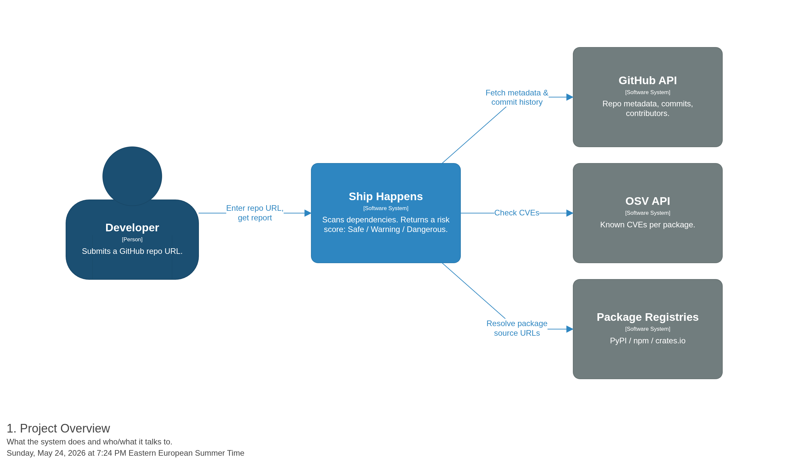
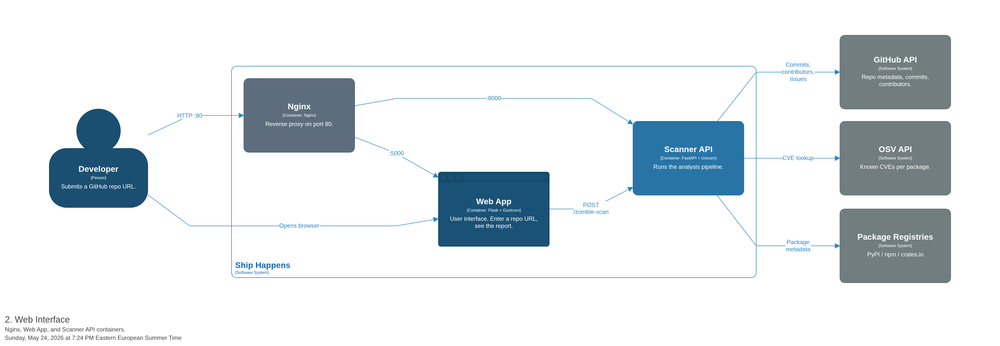
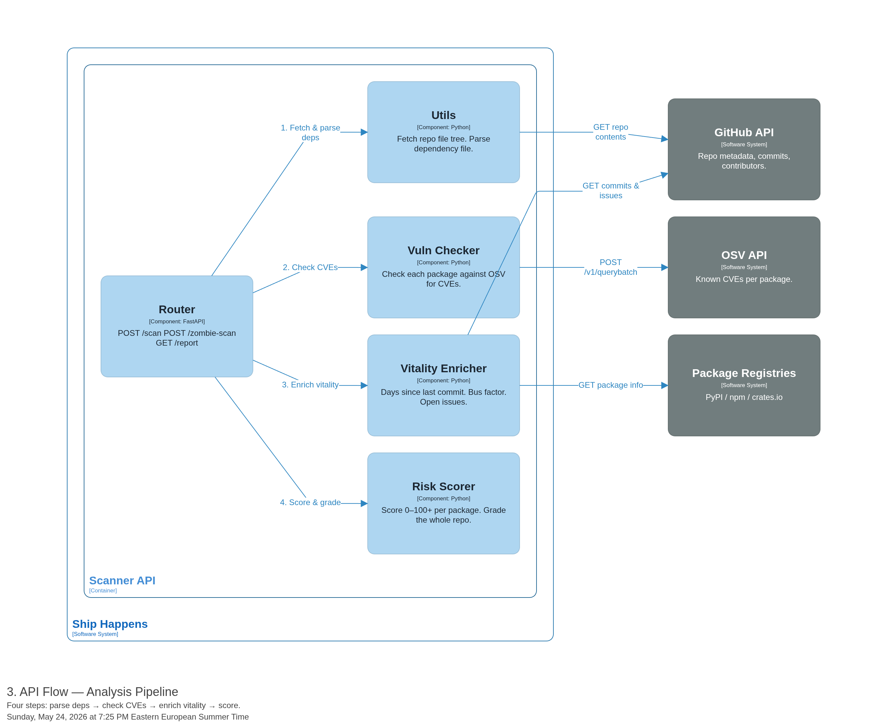

# Ship Happens — System Architecture Report

**Project:** MICAC SoA 2026 · Ship Happens  
**Team:** Ariana Alves · Greivin Sanchez · Juan Torres  

---

## What is Ship Happens?

Ship Happens is a security tool that answers one question:

> *"Is this open-source project safe to use?"*

You give it a GitHub repository URL. It scans every dependency (library) that project relies on and tells you whether any of them are:

- **Vulnerable** — has known security bugs (CVEs)
- **Abandoned** — nobody maintains it anymore ("Zombie Package")

The final output is a grade: **Safe**, **Warning**, or **Dangerous**.

---

## Why does architecture matter here?

The system has two clearly separated jobs:

| Job | Why separate it? |
|---|---|
| **Show a UI to the user** | Needs to be fast and simple |
| **Run the analysis** | Heavy, slow, talks to 3 external APIs |

Splitting them means the web page stays responsive even while the scanner is working. This is the key architectural decision.

---

## Diagram 1 — Project Overview

> *What the system does and who/what it talks to.*



### Reading this diagram

- The **Developer** (you) submits a GitHub URL and gets back a report.
- **Ship Happens** is the whole system — the box in the middle.
- The three boxes on the right are **external services** the system calls:

| External System | Why we call it |
|---|---|
| **GitHub API** | Fetch the repo's file tree, commit history, and contributor count |
| **OSV API** | Check if a package has known CVEs (security bugs) |
| **Package Registries** (PyPI / npm / crates.io) | Find the GitHub source URL for a given package name |

> **Key insight:** Ship Happens never stores your code. It only reads public metadata.

---

## Diagram 2 — Web Interface

> *The internal pieces and how they connect.*



### Reading this diagram

There are three containers (deployed services) inside the system:

| Container | Technology | Role |
|---|---|---|
| **Nginx** | Nginx | Front door. Routes traffic. Port 80 → Web App or Scanner API |
| **Web App** | Flask + Gunicorn | Serves the HTML page. Forwards scan requests to the Scanner API |
| **Scanner API** | FastAPI + Uvicorn | Does the actual analysis. Returns the JSON report |

### Why Nginx?

Nginx sits in front of everything so:
- The user talks to one address (port 80), not two different ports
- It handles SSL, caching, and routing at the network level

### Why two separate services (Flask + FastAPI)?

- **Flask** is lightweight and perfect for serving HTML pages
- **FastAPI** is async and built for API performance — ideal for slow, IO-heavy analysis work
- Keeping them separate means you can scale or replace one without touching the other

---

## Diagram 3 — API Flow (Analysis Pipeline)

> *What happens inside the Scanner API when you submit a repo URL.*



### Reading this diagram

| Step | Component | What it does |
|---|---|---|
| **1** | **Utils** | Fetches the repo's file tree from GitHub. Finds and parses the dependency file (`requirements.txt`, `package.json`, etc.) |
| **2** | **Vuln Checker** | Sends all package names + versions to the OSV API. Gets back a list of known CVEs for each one |
| **3** | **Vitality Enricher** | For each package, finds its GitHub repo (via PyPI/npm) and checks: days since last commit, number of contributors, open issues |
| **4** | **Risk Scorer** | Combines all data into a score (0–100+) per package. Grades the whole repo: **Safe / Warning / Dangerous** |

### Why a pipeline?

Each step depends on the output of the previous one. This makes the code:
- **Testable** — test each step in isolation
- **Extensible** — add a new step without touching the others
- **Debuggable** — when something breaks, you know which step failed

---

## Summary

```
User → Nginx → Web App → Scanner API
                              |
               ┌──────────────────────────┐
               │  1. Parse dependencies   │
               │  2. Check CVEs (OSV)     │
               │  3. Enrich vitality      │
               │  4. Score & grade        │
               └──────────────────────────┘
```

The system is built around three principles:
1. **Separation of concerns** — UI and analysis are independent services
2. **Pipeline architecture** — analysis runs in clear, sequential steps
3. **Public APIs only** — no data is stored, everything is fetched on demand

---

*Diagrams generated with [Structurizr](https://playground.structurizr.com/) using the C4 Model.*  
*DSL source: `../Diagrams/workspace.dsl`*
