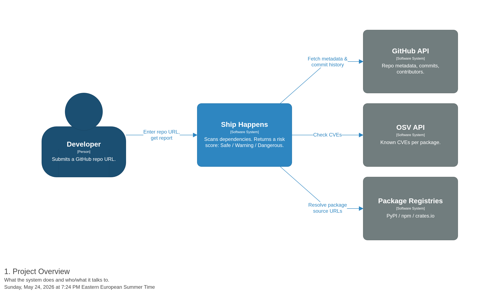
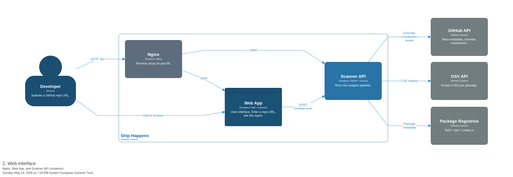
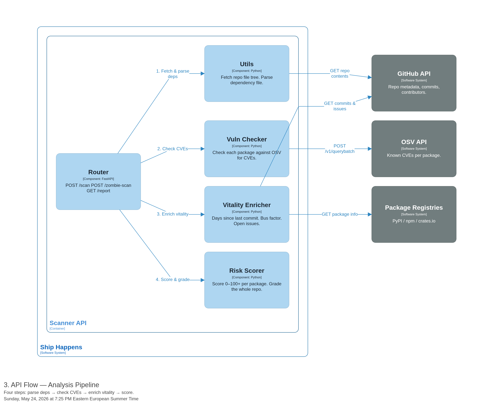

# 3. Methodology

The design of this framework prioritizes a modular architecture capable of automating the
detection of software supply chain risks. Therefore, this chapter describes the system's structural
components and the coordination between internal logic and external data providers, concluding
with a case analysis that demonstrates the practical necessity of the implemented solution.

---

## 3.1. System Architecture

At its most fundamental level, the system acts as an intermediary between the user and global
security databases. The interaction between the auditor, the internal tool, and the external data
sources, specifically the GitHub platform for project activity and the Open Source Vulnerabilities
database, is illustrated in Figure 1.

*Figure 1: Project Overview Diagram*

---

To ensure the tool is accessible both as a desktop application and through a web browser, the
design is partitioned into functional units. This structural division is further detailed in Figure 2,
which depicts how the visual dashboard interacts with the underlying processing services.

*Figure 2: Web Interface Diagram*

---

While the web interface manages user interaction, the technical execution of each audit is
governed by a dedicated communication bridge. As shown in Figure 3, this component orchestrates
the internal lifecycle of a scan, from the initial reading of project manifest files to the simultaneous
collection of security data.

*Figure 3: API Flow Diagram*

---

The physical organization of the project reflects this logical modularity through a cohesive
directory structure. The core analysis engine, located within the `dependency_reader` folder,
implements the logic required to apply the security heuristic, while the `webapp` folder manages the
visual presentation. Operational stability is further maintained through configuration scripts and
environment files, such as `setup.sh` and `requirements.txt`, which ensure that the
tool performs consistently across different computer systems.
